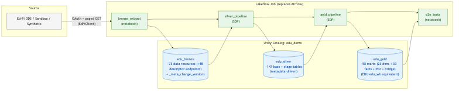

# edu-databricks

A **Databricks-native** replacement for [Enable Data Union (EDU)](https://enabledataunion.org/) — the open-source framework from Education Analytics that pulls data out of an Ed-Fi ODS and lands it in a curated dimensional warehouse.

EDU's published stack is **Airflow + dbt + Snowflake**. This project produces the same warehouse using only **Lakeflow Jobs + Lakeflow Spark Declarative Pipelines + Unity Catalog**. No Airflow. No external dbt. No third-party orchestrator. One platform, end to end.



Built to give any state or local education agency on the Ed-Fi Data Standard a production-grade, single-stack lakehouse pipeline — replacing a hand-written extractor and a multi-tool stack. See [docs/ONBOARDING.md](docs/ONBOARDING.md) to point it at your own institution.

---

## Status, license, and support (read first)

**What this is.** A complete, working reference implementation you deploy into your own
Databricks workspace and own from there. It is a starting point engineered to production
standards, not a managed service and not a licensed product.

**Support.** This project is provided **as-is, without warranty or support commitment**.
It is **not an officially supported Databricks product**, and it is not covered by any
Databricks support agreement, SLA, or maintenance obligation. Once deployed, you own the
code, the pipeline, and the data it produces. If you have questions about adopting it,
raise them with your Databricks account team.

**License.** [PolyForm Noncommercial 1.0.0](LICENSE.md), matching the license of the
upstream Enable Data Union project it reimplements. Free for education agencies to use,
modify, and run. Not licensed for commercial resale or for use in a commercial product or
service. Read [LICENSE.md](LICENSE.md) before redistributing, and confirm the terms work
for your institution.

**How far it has been validated.** End-to-end green on generated synthetic data and on the
Ed-Fi Alliance public sandbox (v7.3.2). It has **not** been row-reconciled against any
agency's production ODS. Reconciliation against your own reports is the acceptance step,
and it is your responsibility: see [§15](#15-production-readiness-checklist) and
[docs/ONBOARDING.md Step 8](docs/ONBOARDING.md). Known limitations are listed honestly in
[§19](#19-honest-gaps).

**Your data stays yours.** Everything runs inside your own Databricks workspace and Unity
Catalog. The pipeline sends no student data anywhere outside it. The only external calls it
makes are to the Ed-Fi API endpoint you configure.

---

## Documentation
New here? Start with **[docs/ONBOARDING.md](docs/ONBOARDING.md)**.
- [docs/ONBOARDING.md](docs/ONBOARDING.md) — **deployment guide**: the step-by-step path from an empty workspace to a warehouse on your own ODS (prerequisites, auth, first run, real ODS, reconcile, production)
- [docs/ENGINEERING_OVERVIEW.md](docs/ENGINEERING_OVERVIEW.md) — full code tour (Bronze → Silver → Gold → QC)
- [docs/MART_PARITY.md](docs/MART_PARITY.md) — mart inventory + business-rule enhancements
- [docs/DESCRIPTOR_RESOLUTION.md](docs/DESCRIPTOR_RESOLUTION.md) — descriptor label resolution design
- [docs/REAL_DATA_VALIDATION.md](docs/REAL_DATA_VALIDATION.md) — live Ed-Fi sandbox validation

---

## Table of contents

1. [Background: what we're solving, and for whom](#1-background-what-were-solving-and-for-whom)
2. [What agencies have today, and why it isn't enough](#2-what-agencies-have-today-and-why-it-isnt-enough)
3. [What Enable Data Union does, and why we couldn't adopt it as-is](#3-what-enable-data-union-does-and-why-we-couldnt-adopt-it-as-is)
4. [Design principles for the rewrite](#4-design-principles-for-the-rewrite)
5. [The Bronze layer — extract from Ed-Fi](#5-the-bronze-layer--extract-from-ed-fi)
6. [The Silver layer — cleansed staging](#6-the-silver-layer--cleansed-staging)
7. [The Gold layer — dimensional warehouse](#7-the-gold-layer--dimensional-warehouse)
8. [The Quality layer — expectations + qc_ tables](#8-the-quality-layer--expectations--qc_-tables)
9. [The Orchestration layer — Lakeflow Job](#9-the-orchestration-layer--lakeflow-job)
10. [The Deployment layer — Databricks Asset Bundle](#10-the-deployment-layer--databricks-asset-bundle)
11. [Architecture Decision Records](#11-architecture-decision-records)
12. [Installation & first run](#12-installation--first-run)
13. [Pointing it at a real Ed-Fi ODS](#13-pointing-it-at-a-real-ed-fi-ods)
14. [Customizing for your district / state](#14-customizing-for-your-district--state)
15. [Production-readiness checklist](#15-production-readiness-checklist)
16. [Repository tour](#16-repository-tour)
17. [Local development & tests](#17-local-development--tests)
18. [Troubleshooting](#18-troubleshooting)
19. [Honest gaps](#19-honest-gaps)
20. [Credits & how to contribute back](#20-credits--how-to-contribute-back)

---

## 1. Background: what we're solving, and for whom

### Who reads this README

State and local education agencies (SEAs and LEAs) that:

- Use the **Ed-Fi Data Standard** to collect SIS data from districts/schools
- Have a **Databricks workspace** (or are willing to stand one up)
- Want a single, supported, dimensional-warehouse-on-the-lakehouse without paying for Snowflake and learning Airflow

If that's you, this project drops Ed-Fi data straight into your Unity Catalog with a curated star schema, data-quality monitoring, and Lakeflow orchestration — without writing 270 dbt SQLs first.

### What is Ed-Fi?

[Ed-Fi](https://www.ed-fi.org/) is the open-source data standard most US state education agencies use to standardize K-12 data exchange. Vendors and SIS providers expose **Ed-Fi ODS APIs** — REST endpoints serving normalized JSON for resources like `students`, `schools`, `sections`, `studentSchoolAssociations`, `studentSchoolAttendanceEvents`, etc.

An Ed-Fi v3 ODS exposes ~70 resources covering students, staff, parents, courses, sections, attendance, grades, assessments, discipline, programs, and surveys. It uses OAuth2 client-credentials authentication, paged GET requests, and supports **change queries** so consumers can pull incrementally instead of full-refreshing.

### Why this is hard for an SEA

The Ed-Fi API gives you the *transactional* shape — every endpoint is normalized to look like its source operational system. Analysts want the *analytical* shape — a star schema with `dim_student`, `fct_student_attendance`, etc. Getting from one to the other is non-trivial:

- ~70 endpoints to extract incrementally
- Each endpoint has nested JSON arrays and Ed-Fi "descriptor" URIs that need parsing
- Need to deduplicate, type, surrogate-key
- Need to model dimensions that pull from 3-5 source endpoints each (e.g., `dim_student` combines `students`, `studentEducationOrganizationAssociations`, and the most-recent `studentSchoolAssociation`)
- Need to maintain incremental loads using change versions
- Need to validate everything stays internally consistent (FKs, descriptors, business rules)

That's a 1–2 engineer-year project to build well. Hence frameworks like EDU.

---

## 2. What agencies have today, and why it isn't enough

A typical state education agency runs this loop in production:

```
Ed-Fi ODS
       │
       ▼
Custom Python notebook (hand-written, maintained by a single engineer)
  - Pulls each Ed-Fi endpoint
  - Writes to Delta tables with some bronze/silver mixed naming
       │
       ▼
Delta tables in a Databricks catalog (no curated warehouse layer)
```

It works. Daily ingestion happens. But it has six recurring problems any hand-written extractor tends to hit:

| Problem                                                                  | Impact                                                                                                |
| ------------------------------------------------------------------------ | ----------------------------------------------------------------------------------------------------- |
| Spark OOM failures requiring manual memory tuning                         | Pipeline failures, on-call work, weekend escalations                                                 |
| No curated dimensional warehouse — bronze and silver intermixed in one catalog | Analysts write the same JSON-unpacking SQL over and over                                              |
| No data-quality monitoring                                               | Issues land in dashboards before they're noticed                                                      |
| Single-author code with no documented owner                              | Knowledge concentrated in one person; hard to hand over                                               |
| Not orchestrated as a real DAG                                           | No retries, no alerting, no incremental-load contract                                                |
| Not extensible by people who don't know the codebase                     | Adding a new resource requires reading the whole notebook                                            |

The goal: **same Ed-Fi data → a curated, supported, dimensional warehouse, on the same Databricks platform the agency already pays for, without learning Airflow or Snowflake.**

---

## 3. What Enable Data Union does, and why we couldn't adopt it as-is

[Enable Data Union](https://github.com/edanalytics/edu_wh) is an open-source framework from [Education Analytics](https://edanalytics.org/) — a non-profit that builds analytical infrastructure for state education agencies. It is used in production by state education agencies today.

It's three repos:

| Repo                                                                       | What it does                                                  |
| -------------------------------------------------------------------------- | ------------------------------------------------------------- |
| [`edu_edfi_airflow`](https://github.com/edanalytics/edu_edfi_airflow)      | Apache Airflow DAGs: schedule, retry, monitor extraction      |
| [`edfi_api_client`](https://github.com/edanalytics/edfi_api_client)        | Python library: OAuth2 + paging + change-query Ed-Fi v3 client |
| [`edu_edfi_source`](https://github.com/edanalytics/edu_edfi_source)        | dbt package: **269 SQL files** typing JSON into base + stage tables |
| [`edu_wh`](https://github.com/edanalytics/edu_wh)                          | dbt package: **120 SQL files** producing the dimensional warehouse |

Architecturally:

```
Ed-Fi ODS  →  Airflow DAG (every resource, scheduled)  →  S3 (raw JSON)  →  Snowflake VARIANT staging
                                                                                    │
                                                                                    ▼
                                                                          dbt run (edu_edfi_source)
                                                                                    │
                                                                                    ▼
                                                                          dbt run (edu_wh)
                                                                                    │
                                                                                    ▼
                                                                  Snowflake star schema (~57 marts)
```

This is **correct and battle-tested**. We are not improving on EDU's design philosophy — we're translating it onto a different platform.

### Why most Databricks customers can't adopt EDU as-is

1. **Airflow.** Many agencies don't run Airflow and have no Airflow practitioners. Setting up an Airflow cluster, securing it, integrating with their identity, monitoring it, and training staff is a 6-month project on its own.
2. **dbt.** Many agencies don't run dbt and don't want to take on a second transformation framework as a new skill burden — they want everything in one stack.
3. **Snowflake.** They're already paying for Databricks. They have no Snowflake contract and no appetite to add one.
4. **EDU was designed for AWS+Snowflake.** Its published stack assumes S3 and Snowflake, so there is no ready-made Databricks path. Without one, every Databricks adopter repeats the same translation from scratch.

So: the **contract** EDU defines (this is what the warehouse should look like, this is what the surrogate keys are, this is how the staging tables shape the JSON) is exactly right and we keep it. The **implementation** doesn't fit the platform, so we rewrite it.

---

## 4. Design principles for the rewrite

Seven design calls were made upfront. They show up everywhere in the code, so it's worth stating them explicitly before walking through any one file.

### 4.1 Single-stack on Databricks

Every runtime dependency is something Databricks ships or owns: Delta, Unity Catalog, Lakeflow Jobs, Lakeflow Spark Declarative Pipelines (formerly DLT), Databricks Asset Bundles, serverless compute. The only Python deps are `requests` and `pyyaml` (and `pyspark`, which is part of the runtime).

**Why:** the common problem is operating too many stacks. Adopting another tool to solve the "we have too many tools" problem is the wrong move.

### 4.2 Declarative > imperative everywhere we can be

- Silver and Gold are **Spark Declarative Pipelines** (`@dlt.table`): you declare what the tables *are*; Lakeflow figures out dependency order, retries, recovery.
- Bronze is the only imperative layer — it has to be, because it manages OAuth tokens and incremental state.
- Data quality is `@dlt.expect_*`, not `if x: raise`.
- The DAG is YAML (`resources/ingestion_job.yml`), not Python.

**Why:** Declarative code is auditable and self-documenting. Lakeflow knows things about declarative pipelines (dependency graph, refresh strategy, expectation metrics) that it can't know about imperative ones.

### 4.3 Honor the contract, not the implementation

EDU's external contract is:

- A dimensional warehouse with these specific marts (`dim_student`, `fct_student_school_attendance_event`, etc.)
- Surrogate keys generated by this specific formula (`md5(lower(concat_ws('-', parts...)))`)
- A specific incremental-load semantics (change versions)
- A specific staging shape (one `base_ef3__X` view + one `stg_ef3__X` table per Ed-Fi resource)

We match the contract byte-for-byte. We do **not** match the implementation — we don't have 269 SQL files, we have one Python script that generates them.

**Why:** This keeps EDU-trained analysts productive on day one. Their SQL muscle memory transfers directly. Any tool that consumes EDU's gold contract can consume ours.

### 4.4 Metadata-driven where the work is mechanical

Of EDU's 269 staging SQLs, ~95% are *the same shape*: extract some JSON fields, type them, generate a surrogate key, dedupe. Hand-writing 269 files of mechanical SQL is wasted effort and a maintenance trap. We define each resource **once** in `resources.yml`, and `src/silver/pipeline.py` generates both the base view and the stage table programmatically.

Gold marts, by contrast, have **real business logic** (joins, window functions, calendar arithmetic, descriptor lookups). Those we hand-write — one `@dlt.table` function per mart.

**Why:** Right tool, right job. Generation for the mechanical, code for the meaningful.

### 4.5 Two complementary layers of data quality

- **Inline `@dlt.expect_*` expectations** on individual tables show up live in the Lakeflow Pipeline UI. They are the operational pulse — "did this run produce clean data?"
- **`qc_*` summary tables** in `edu_gold` are queryable. They feed dashboards, alerts, Genie spaces, and historical trend analysis.

Both run in the same SDP. Both are Databricks-native. No third party.

**Why:** EDU's `models/qc/` provides the latter. dbt tests provide the former. We needed both, in the native Databricks idiom.

### 4.6 Everything is deployable as code

`databricks bundle deploy` is the only deployment step. Jobs, pipelines, schemas, parameters — all expressed in YAML and Python in this repo. Zero click-ops in the workspace UI.

**Why:** Bus factor. Repeatability. Multi-environment promotion (dev → staging → prod). Education-agency data teams are typically small; the deployment has to be self-service for someone six months from now.

### 4.7 Fail closed on data quality

The job has an explicit E2E test task that runs *after* gold. If primary-key uniqueness, FK resolution, or business invariants break, the **job fails**, blocking downstream consumers from seeing bad data. We use job-level email notifications + the SDP UI's DQ tab for visibility.

**Why:** "Bad data delivered fast" is worse than "good data delivered slow." For an SEA reporting to ED.gov, defensible numbers matter more than dashboard freshness.

---

## 5. The Bronze layer — extract from Ed-Fi

### What it does

Pulls every resource defined in `src/edfi_extract/resources.yml` from an Ed-Fi v3 ODS (or the public sandbox, or a synthetic generator), lands each as a Delta table in `{catalog}.edu_bronze`, and maintains a change-version watermark for incremental loads.

```
Ed-Fi ODS  →  notebooks/00_extract_bronze.py  →  edu_bronze.{resource}_raw  +  edu_bronze._meta_change_versions
```

### Why Python notebook, not SDP

SDP is **declarative**. The bronze layer is **imperative**:

- Refresh OAuth tokens when they expire
- Track the last successful change version per resource
- Page through results with exponential backoff on transient HTTP errors
- Handle 401 by re-authenticating mid-flight

That's stateful, branching logic. Notebook task is the right primitive.

### `src/edfi_extract/client.py`

A focused, dependency-free Ed-Fi v3 API client. The class is `EdFiClient` with three public methods:

```python
client.get_latest_change_version() -> int
client.get_resource(path, min_change_version=None, max_change_version=None) -> Iterator[List[dict]]
client.get_deletes(path, ...) -> Iterator[List[dict]]      # /deletes tombstones
client.get_key_changes(path, ...) -> Iterator[List[dict]]  # /keyChanges
```

Internally:

- `_refresh_token()` does the OAuth2 client-credentials flow, caches the token with a 120-second early-refresh buffer so a token never goes stale mid-pull
- `_get()` retries on 401/408/429/5xx with exponential backoff (max 60s); 401 forces a re-auth on retry; **404 raises a typed `EdFiNotFound`** so version-gated endpoints can be skipped instead of failing the run
- Change-version windows are pulled in **50,000-CV sub-windows** (no deep offsets on large resources) and each window is paged in **reverse offset order** — rows shifting between pages mid-pull then produce duplicates (absorbed by Silver dedupe) instead of silent misses. This mirrors `edfi_api_client`'s miss-protection.
- `get_resource` yields *pages* (not individual records) so the caller can write in batches without buffering the whole resource in memory

**Compare to EDU's `edfi_api_client`:** Same contract and the same edge-case behaviors that matter (CV windows, reverse paging, deletes, token early-refresh), minus the composite/descriptor helpers this project doesn't use.

### `src/edfi_extract/resources.yml`

This is the single source of truth for "what does Bronze pull?":

```yaml
resources:
  - name: students
    path: ed-fi/students
    key_paths:
      - studentUniqueId
  - name: student_school_associations
    path: ed-fi/studentSchoolAssociations
    key_paths:                              # FULL JSON paths, validated against
      - studentReference.studentUniqueId    # the Ed-Fi 7.3 OpenAPI spec —
      - schoolReference.schoolId            # most Ed-Fi keys live inside
      - entryDate                           # *Reference objects, never assume
      - schoolYearTypeReference.schoolYear  # top-level
  - name: parents
    path: ed-fi/parents
    optional: true                          # removed in DS 5.x: 404 -> skipped
    key_paths: [parentUniqueId]
  ...
```

Each row produces:

- One bronze raw table (`students_raw`)
- One silver base view (`students_base`)
- One silver stage table (`students`)

Adding a new Ed-Fi resource = one YAML row. That's it. No other code changes needed for a basic landing.

### `src/edfi_extract/extractor.py`

The orchestrator. `extract_all(spark, config)` takes **one change-version snapshot for the whole run** (so the raw layer never drifts across resources — same rule as `edu_edfi_airflow`), then walks the manifest and for each resource:

1. Reads the watermark from `_meta_change_versions` — keyed by **(tenant_code, api_year, resource, kind)** so multiple years/tenants coexist and deletes carry their own watermark
2. Guards the window: `snapshot < watermark` → hard error (ODS restored from backup; run `full_refresh=true`); `snapshot == watermark` → resource skipped as unchanged
3. Calls the API with `minChangeVersion = watermark + 1, maxChangeVersion = snapshot`
4. Pages through and converts each record into a row of:
   ```
   (tenant_code, api_year, pull_timestamp, pull_change_version, record_guid, payload)
   ```
   where `payload` is the raw JSON record as a STRING
5. Pulls the resource's **/deletes tombstones** into the shared `edu_bronze._deletes_raw` table (Silver anti-joins them out)
6. Writes append-mode to `edu_bronze.{name}_raw` (full refresh deletes the tenant/year slice first)
7. MERGEs the new high-water marks into `_meta_change_versions`

Failure isolation: a 404 on an `optional` endpoint marks it skipped (e.g. `parents` on a DS 5.x ODS); any other per-resource failure is recorded, the remaining resources still run, and the job fails at the end with a summary. A failed resource's watermark is not advanced, so it is automatically re-pulled next run.

### Why Delta, not S3+VARIANT like EDU does

EDU lands raw JSON in S3, then COPYs into Snowflake VARIANT columns. We collapse that two-hop landing into a direct Delta write because:

- **Delta is the lakehouse-native open format.** Object storage + table format in one.
- **Delta supports `STRING` payload columns just fine** — we use `get_json_object()` and `from_json()` downstream, same as EDU does with Snowflake's `:` operator.
- **No additional integration to maintain** — every other Databricks tool reads Delta natively.

Trade-off: we don't get Snowflake VARIANT's schema-discovery features. We use explicit JSON-path extraction in Silver instead.

### Synthetic mode

When `data_mode = synthetic`, `extract_all` short-circuits the API client and calls `synthetic.generate_synthetic_dataset()` instead. This produces deterministic Ed-Fi JSON whose payload shapes are **validated against the Ed-Fi 7.3 OpenAPI spec** — references nested exactly as the real API returns them, a stable GUID `id` on every record, and delete tombstones for records that exist in the data. The rules (enforced by `tests/unit/test_synthetic.py`):

- **Every endpoint that exists on a 7.3 ODS generates rows.** A resource with zero rows would silently skip its code path — that's how bugs hide behind green tests.
- **Every manifest `key_path` and every silver recipe path must resolve on the generated payloads.** If the generator and the spec disagree, the test fails — synthetic data is never allowed to be shaped "to make the code work".
- Endpoints that do **not** exist on DS 5.x (`parents`, `studentParentAssociations`, `studentDisciplineIncidentAssociations`) are omitted entirely, so synthetic runs exercise the same 404-skip path a real ODS triggers.
- `_deletes` tombstones reference real generated records, so delete propagation through Silver is exercised end-to-end on every run.

The generator uses `random.Random(seed)` everywhere, so the same seed produces bit-identical output every time. The result: the pipeline runs end-to-end without credentials, CI/CD runs the same code path as prod, demos work offline — and a synthetic run actually proves the code works.

---

## 6. The Silver layer — cleansed staging

### What it does

For every resource in `resources.yml`, produces two tables:

- `{resource}_base` — typed columns extracted from `payload` JSON + the raw payload preserved (EDU's `base_ef3__*`)
- `{resource}` — deduplicated by a surrogate key (EDU's `stg_ef3__*`)

147 silver tables total, 0 hand-written SQL.

### Why a Spark Declarative Pipeline

Silver is purely declarative:

- "This table is `payload` JSON unpacked into typed columns"
- "This table is the previous table deduplicated on a surrogate key"

SDP shines here. We get:

- Automatic dependency resolution (stage tables depend on base tables; SDP knows)
- Recovery semantics (re-run a failed table without restarting the whole pipeline)
- DQ expectations as a first-class feature
- A pipeline UI showing what tables exist, when they were refreshed, and per-expectation pass rates

### Why metadata-driven, not hand-coded SQL

EDU writes 269 SQLs that all look like this:

```sql
-- base_ef3__students.sql
with students as (
    {{ source_edfi3('students') }}
),
renamed as (
    select
        tenant_code, api_year, pull_timestamp, ...,
        v:studentUniqueId::string  as student_unique_id,
        v:firstName::string        as first_name,
        v:birthDate::date          as birth_date,
        ...
    from students
)
select * from renamed
```

The variation between any two of these files is **just the field list**. Maintaining 269 hand-written shells of the same template is anti-pattern.

We define the field list as a Python dict (`RECIPES` in `src/silver/recipes.py`):

```python
RECIPES = {
    "students": {
        "student_unique_id": "$.studentUniqueId",
        "first_name":        "$.firstName",
        "birth_date":        "$.birthDate",
        ...
    },
    "schools": {
        "school_id":            "$.schoolId",
        "name_of_institution":  "$.nameOfInstitution",
        ...
    },
    ...
}
```

And the loop at the bottom of the file generates one `@dlt.table` per resource:

```python
for resource in _load_resources():
    _make_base_table(resource)    # registers @dlt.table named '{name}_base'
    _make_stage_table(resource)   # registers @dlt.table named '{name}'
```

Each `_make_base_table` does:

```python
@dlt.table(name=f"{name}_base", comment=...)
def _base():
    df = spark.read.table(f"{catalog}.{bronze}.{name}_raw")
    cols = [F.col("tenant_code"), F.col("api_year"), ..., F.col("payload")]
    for silver_col, json_path in RECIPES[name].items():
        cols.append(get_json(F.col("payload"), json_path).alias(silver_col))
    return df.select(*cols)
```

Each `_make_stage_table` does:

```python
@dlt.table(name=name, comment=...)
@dlt.expect_all({"tenant_code_not_null": "...", "k_{name}_not_null": "..."})
def _stage():
    df = dlt.read(f"{name}_base")
    # Build surrogate key from resource.key_paths
    df = df.withColumn(f"k_{name}", surrogate_key(tenant_code, api_year, *sk_cols))
    return dedupe_latest(df, partition_by=[f"k_{name}"], order_by=["pull_change_version", "pull_timestamp"])
```

That's the entire silver layer. ~250 LOC instead of 269 files. Adding a resource = one YAML row + (optionally) one `RECIPES` entry for typed columns.

### `src/silver/transforms.py`

Three helpers do 95% of EDU's macro work:

| Helper                                                     | EDU equivalent                                       |
| ---------------------------------------------------------- | ---------------------------------------------------- |
| `extract_descriptor(col)`                                  | `extract_descriptor` macro                           |
| `surrogate_key(*cols, lowercase=True)`                     | `dbt_utils.generate_surrogate_key`                    |
| `dedupe_latest(df, partition_by, order_by)`                | `dbt_utils.deduplicate`                              |

The `surrogate_key` implementation matters because **every gold join depends on byte-equivalent keys**:

```python
def surrogate_key(*cols, lowercase=True):
    NULL_MARKER = "_dbt_utils_surrogate_key_null_"
    parts = []
    for c in cols:
        s = F.coalesce(F.col(c).cast("string"), F.lit(NULL_MARKER))
        if lowercase:
            s = F.lower(s)
        parts.append(s)
    return F.md5(F.concat_ws("-", *parts))
```

That formula is exactly what `dbt_utils.generate_surrogate_key()` produces. An analyst running EDU's dbt against our bronze, or running our SDPs against EDU's bronze, gets the same `k_student` values either way.

### SDP expectations on Silver

Every silver stage table gets these annotations automatically:

```python
@dlt.expect_all({
    "tenant_code_not_null": "tenant_code IS NOT NULL",
    "api_year_not_null":    "api_year IS NOT NULL",
    f"k_{name}_not_null":   f"k_{name} IS NOT NULL",
})
```

These are *warning* expectations (not `_or_fail`), so a single bad row doesn't kill the pipeline — but the SDP UI surfaces the pass/fail count per expectation per run, and the `qc_*` tables (next section) capture trends.

---

## 7. The Gold layer — dimensional warehouse

### What it does

Produces 58 hand-written dim/fct/msr/brg marts in `edu_gold`, matching EDU's `core_warehouse` + `tpdm_warehouse` model surface.

### Why hand-written, not generated

Gold marts have real business logic:

- `dim_student` joins three silver tables and computes "most recent enrollment" via a window function
- `fct_student_school_attendance_event` derives `is_absent` from the descriptor pattern and computes durations
- `msr_student_cumulative_attendance` aggregates daily attendance into attendance rate by student-year
- `fct_student_diploma` filters academic records to those with a diploma award

You can't generate that from a YAML manifest. You write it once, intentionally.

### Star schema design

Dimensions (23): `dim_lea`, `dim_school`, `dim_session`, `dim_grading_period`, `dim_calendar_date`, `dim_course`, `dim_course_section`, `dim_staff`, `dim_student`, `dim_assessment`, `dim_esc`, `dim_network`, `dim_program`, `dim_cohort`, `dim_parent`, `dim_class_period`, `dim_classroom`, `dim_learning_standard`, `dim_objective_assessment`, `dim_graduation_plan`, `dim_school_calendar`, `dim_candidate` (TPDM), `dim_educator_preparation_program` (TPDM).

Facts (33): enrollment, section enrollment, attendance (school + section + daily roll-up), grades, assessment, learning-standard grades, objective-assessment scores, discipline (actions + incidents, raw + summaries + behaviors + non-offenders), staff assignment, all program associations (special-ed, homeless, ELL, Title I-A, CTE, migrant, food service), program services, parent association, cohort association, academic record, GPA, course transcripts, diploma, subgroup, candidate-program association (TPDM).

Plus 1 measure (`msr_student_cumulative_attendance`), 1 bridge (`brg_course_section_program`), and 7 quality tables (`qc_*`).

Every fact joins to its dimensions on `k_*` surrogate keys. Every key is computed by the helpers in `src/gold/shared/keys.py` — exactly matching EDU's `dbt_utils.generate_surrogate_key`. **This is why this project is interoperable with EDU**: an EDU-trained analyst's SQL works against our gold layer with zero modification.

### Anatomy of a gold mart

Here's `dim_student` from `src/gold/pipeline.py`:

```python
@dlt.table(name="dim_student", comment="Student dimension. Replaces edu_wh.core_warehouse.dim_student.")
@dlt.expect_all({
    "k_student_not_null": "k_student IS NOT NULL",
    "student_unique_id_not_null": "student_unique_id IS NOT NULL",
})
def dim_student():
    stu = _silver("students")
    eo  = _silver("student_education_organization_associations").select(
        "tenant_code", "api_year", "student_unique_id",
        extract_descriptor(F.col("sex_descriptor")).alias("gender"),
        extract_descriptor(F.col("limited_english_proficiency_descriptor")).alias("lep_code"),
        F.col("hispanic_latino_ethnicity").cast("boolean").alias("has_hispanic_latino_ethnicity"),
    )
    ssa = _silver("student_school_associations").select(
        "tenant_code", "api_year", "student_unique_id", "school_id",
        extract_descriptor(F.col("entry_grade_level_descriptor")).alias("grade_level"),
        F.col("entry_date").cast("date").alias("entry_date"),
    )
    # most-recent school per student
    latest = ssa.withColumn("_rn",
        F.row_number().over(Window.partitionBy("tenant_code", "api_year", "student_unique_id")
                                  .orderBy(F.col("entry_date").desc()))
    ).filter("_rn = 1").drop("_rn")

    return (stu
        .join(eo,     on=["tenant_code", "api_year", "student_unique_id"], how="left")
        .join(latest, on=["tenant_code", "api_year", "student_unique_id"], how="left")
        .select(
            k_student("tenant_code", "api_year", "student_unique_id").alias("k_student"),
            k_student_xyear("tenant_code", "student_unique_id").alias("k_student_xyear"),
            F.col("tenant_code"),
            F.col("api_year").alias("school_year"),
            F.col("student_unique_id"),
            F.col("first_name"), F.col("middle_name"), F.col("last_name"),
            F.concat_ws(" ", "first_name", "last_name").alias("display_name"),
            F.col("birth_date").cast("date").alias("birth_date"),
            extract_descriptor(F.col("birth_sex_descriptor")).alias("birth_sex"),
            F.col("gender"), F.col("lep_code"), F.col("has_hispanic_latino_ethnicity"),
            F.col("grade_level"), F.col("school_id"), F.col("entry_date"),
        )
    )
```

Things to notice:

- **`@dlt.table` declares the table.** Lakeflow handles scheduling, refresh, recovery.
- **`@dlt.expect_all` declares DQ rules** inline. These show up as live metrics in the pipeline UI.
- **`_silver("...")`** is a small helper that reads a silver table — we can swap implementation later (CDF reads, time travel, schema-named overrides) without touching the marts.
- **Surrogate keys are constructed via the `k_student`, `k_student_xyear` helpers** — guaranteed to match EDU.
- **`extract_descriptor`** strips Ed-Fi's `uri://x.org/Foo#Bar` to just `Bar`, same as EDU's macro. It is now idempotent (a value already reduced to its codeValue passes through unchanged), because Silver resolves most descriptor codes to their human `shortDescription` via the `_descriptors` lookup before Gold ever sees them — only key-feeding descriptors stay as the raw URI. See [docs/DESCRIPTOR_RESOLUTION.md](docs/DESCRIPTOR_RESOLUTION.md).

Read `src/gold/pipeline.py` straight through. Every mart is ~20–60 lines of PySpark and is named after the EDU model it replaces. Consistent across the file.

### TPDM (Teacher Preparation Data Model)

EDU has a `tpdm_warehouse` package for teacher-prep data. We've built the three core TPDM marts (`dim_candidate`, `dim_educator_preparation_program`, `fct_candidate_educator_preparation_program_association`) and added the three TPDM Ed-Fi endpoints to `resources.yml`. If your state doesn't enroll the TPDM extension, these tables come up empty — harmless.

### Business-rule features
Beyond the structural marts, four business-rule features are built, tunable via bundle variables, and validated on synthetic data **and** the live Ed-Fi public sandbox:
- **Descriptor labels** — Ed-Fi descriptor codes resolve to human `shortDescription`s via a Silver `_descriptors` lookup (key-feeding descriptors stay as codeValue for key parity).
- **Chronic absenteeism** — `is_chronically_absent` on `msr_student_cumulative_attendance` (present < 90% over ≥ 20 days; tunable).
- **Program active/annual** — `is_active`/`is_annual` on the program-association facts; `fct_student_subgroup` counts active membership only, so exited students don't inflate counts.
- **Demographic rollup** — `dim_student.race_ethnicity` (federal Hispanic→Latinx / multi→Multiple / none→Unknown rollup; tunable labels).

See [docs/MART_PARITY.md](docs/MART_PARITY.md) and [docs/DESCRIPTOR_RESOLUTION.md](docs/DESCRIPTOR_RESOLUTION.md).

---

## 8. The Quality layer — expectations + `qc_` tables

EDU has a `models/qc/` directory of dbt models that emit quality-summary tables, and a comprehensive set of dbt tests. We have two complementary mechanisms covering the same ground.

### 8a. Inline SDP expectations (operational pulse)

Every silver staging table and every key gold mart is decorated with `@dlt.expect_all(...)`:

```python
@dlt.expect_all({
    "k_student_not_null": "k_student IS NOT NULL",
    "k_course_section_not_null": "k_course_section IS NOT NULL",
    "numeric_grade_in_range":
        "numeric_grade_earned IS NULL OR (numeric_grade_earned >= 0 AND numeric_grade_earned <= 100)",
})
def fct_student_grades():
    ...
```

These show up live in the **Lakeflow Pipeline UI → Data Quality tab**. For every run, you see:
- How many rows hit each expectation
- How many violated it
- Trend over time

This is the operational pulse. "Did the pipeline just produce clean data, right now?"

### 8b. `qc_*` summary tables (queryable history)

The gold SDP also produces 7 tables in `edu_gold` that capture quality state as queryable data:

| Table                       | What's in it                                                                                       |
| --------------------------- | -------------------------------------------------------------------------------------------------- |
| `qc_row_counts`             | Row count for every bronze/silver/gold table, snapshotted at run time.                              |
| `qc_dim_pk_audit`           | For each dimension: total rows, distinct keys, null keys, duplicate count, `is_clean` boolean.      |
| `qc_fct_fk_audit`           | For each fact-FK pair: count of fact rows whose FK doesn't resolve to a dim row.                    |
| `qc_descriptor_audit`       | For each descriptor column: count of NULLs and values that don't match `uri://x#y` shape.           |
| `qc_freshness`              | Per Ed-Fi resource: last pull timestamp, last change version, last row count.                       |
| `qc_business_invariants`    | Per business rule (attendance/absent consistency, grade range, GPA range, diploma-after-entry): breach count. |
| `qc_scorecard`              | One row per check across all categories with `PASS`/`FAIL` status — wire this to a dashboard.       |

These let an analyst:

- Run `SELECT * FROM edu_gold.qc_scorecard WHERE status = 'FAIL'` to triage
- Build a Lakeview dashboard trending DQ over time
- Point a Genie space at `qc_*` for natural-language Q&A

### 8c. Hard-gate E2E test task

The job's final task (`notebooks/99_run_e2e_tests.py`) runs `AssertionError`-based checks against gold. The same PK uniqueness, FK resolution, and business-invariant checks the `qc_*` tables surface as data — here they're assertions that **fail the job** if violated. Downstream consumers are blocked from seeing bad data.

---

## 9. The Orchestration layer — Lakeflow Job

`resources/ingestion_job.yml` is the DAG:

```yaml
tasks:
  - task_key: bronze_extract         # notebook task: imports edfi_extract, calls extract_all
  - task_key: silver_pipeline        # pipeline task: triggers the silver SDP, full_refresh: false
    depends_on: [{task_key: bronze_extract}]
  - task_key: gold_pipeline          # pipeline task: triggers the gold SDP
    depends_on: [{task_key: silver_pipeline}]
  - task_key: e2e_tests              # notebook task: hard-gate assertions
    depends_on: [{task_key: gold_pipeline}]

schedule:
  quartz_cron_expression: "0 0 5 * * ?"   # 5am Eastern daily
  pause_status: PAUSED                     # off by default in dev

# email_notifications:                               # commented seam in the file —
#   on_failure: [data-team@your-agency.example.gov]  # uncomment and set your own
```

### Why Lakeflow over Airflow

| Concern                        | Lakeflow Jobs                                              | Airflow                                                                |
| ------------------------------ | ---------------------------------------------------------- | ---------------------------------------------------------------------- |
| Deployment surface             | Already in your Databricks workspace, zero new infra        | Standalone cluster, scheduler, webserver, metadata DB, secrets, identity |
| Lineage to data                | Native — Lakeflow tasks know they wrote to UC tables       | Custom integration                                                     |
| Failed-task observability      | Native UI with logs, retries, run history                  | Native (good)                                                          |
| Pipeline-task as first class   | Yes (`pipeline_task` runs an SDP refresh)                  | Custom operator                                                        |
| Compute economics              | Pay only when tasks run, serverless by default              | Cluster + scheduler runs 24/7                                          |
| Operability for a 2-person team | Low — same console as everything else                      | High — separate skill                                                  |

For a state agency with a small data team, Lakeflow's value isn't that it's strictly more powerful than Airflow — it's that it's *already there*.

---

## 10. The Deployment layer — Databricks Asset Bundle

`databricks.yml` is the bundle root. It declares:

- **Variables** (catalog, schemas, Ed-Fi credentials, data mode, tenant code, school year)
- **Targets** (dev, prod) with per-target workspace + permission overrides
- **Includes** that pull in `resources/*.yml`

A `databricks bundle deploy` does the following atomically:

1. Validates the bundle (schema-checks every YAML, lints Python imports)
2. Uploads source files to `/Workspace/Users/<you>/.bundle/<bundle>/<target>/files/`
3. Creates or updates: the Job, both Pipelines, the schemas, the parameter defaults, the schedule, the notifications
4. Runs through a state-diff (similar to Terraform) so existing resources are updated in place, not recreated, when possible

This is the deployment model. There's no separate CI script. CI pipelines just run `databricks bundle deploy -p ${env}` after running tests.

For multi-environment (dev → staging → prod), you'd:
- Add `targets.staging` and `targets.prod` blocks in `databricks.yml`
- Use per-target variable overrides for catalog names, schedule pause states, etc.
- Deploy with `databricks bundle deploy -t prod`

---

## 11. Architecture Decision Records

Short, opinionated answers to "why didn't you just...?"

### ADR-001: Why no Airflow?

Most adopting agencies don't run Airflow and don't want to. Lakeflow Jobs cover every Airflow feature this pipeline needs (sequential tasks, retries, schedules, failure alerts) and integrate natively with the rest of the stack. **Choosing Airflow would be choosing a problem.**

### ADR-002: Why no dbt?

Same reason. SDP is the Databricks-native equivalent of dbt: declarative table definitions, automatic dependency resolution, native DQ via `@dlt.expect_*`, lineage into Unity Catalog. Customers adopting this project should not need to operate a second transformation framework — that's the entire premise. We will not document or support a "run EDU dbt instead" fallback because it dilutes the single-stack commitment that makes this project worth shipping.

### ADR-003: Why metadata-driven Silver instead of hand-written SQL?

EDU's 269 staging SQLs are 95% boilerplate of the same shape. Maintaining 269 files of mechanical SQL is anti-pattern. We define each resource once in `resources.yml` and generate two SDP tables programmatically. Adding a resource = one YAML row.

### ADR-004: Why hand-written Gold marts?

Because they have real business logic that's not derivable from a manifest. Joins, windows, descriptor lookups, calendar arithmetic. Writing each `@dlt.table` function intentionally is correct.

### ADR-005: Why Delta for bronze instead of S3+VARIANT?

Delta *is* the lakehouse-native open format. Skipping the object-storage hop saves an operator, an IAM grant, and a failure mode. We use `get_json_object` and `from_json` for the unpacking, which is functionally equivalent to Snowflake's `:` operator.

### ADR-006: Why surrogate-key formulas matching `dbt_utils` exactly?

Interoperability. An EDU-trained analyst's SQL works against our gold tables unchanged because `k_student` here equals `k_student` in any other EDU deployment. Dashboards and reports built against EDU's contract drop in on day one.

### ADR-007: Why SDP expectations AND `qc_*` tables?

Different audiences, different timescales:

- **SDP expectations** are the operational pulse — "did this run produce clean data?" They appear live in the pipeline UI per run.
- **`qc_*` tables** are queryable history — "is data quality trending up or down over the last 30 days?" They feed dashboards and Genie.

EDU has both (dbt tests + `models/qc/`). We mirror that, in the Databricks idiom.

### ADR-008: Why DAB?

It's the supported, declarative, code-as-config deployment model for Databricks. Resources are versioned in git, multi-environment promotion is a flag, and there's no click-ops baseline to drift from.

---

## 12. Installation & first run

> **Adopting this for your own institution? Follow [docs/ONBOARDING.md](docs/ONBOARDING.md) instead** — it is the ordered, step-by-step deployment guide, with a check after each step. The sections below are the reference detail behind it.

### Prerequisites

1. **A Databricks workspace** with Unity Catalog enabled.
2. **A user (or service principal)** with permission to:
   - Create catalogs/schemas (or pre-provisioned grants on existing ones)
   - Create Jobs and Pipelines
   - Run serverless compute
3. **Databricks CLI v0.230+** installed locally:
   ```bash
   # macOS
   brew install databricks
   # Linux/Windows: see https://docs.databricks.com/dev-tools/cli/install.html
   databricks --version  # should report v0.230 or later
   ```
4. **Terraform v1.5+** on `PATH` (DAB uses it under the hood):
   ```bash
   brew install terraform
   ```

### Authenticate

```bash
databricks auth login --host https://<your-workspace>.cloud.databricks.com
# Pick a profile name when prompted, e.g. "my-workspace".

databricks current-user me -p my-workspace
```

For service-principal deployments (CI/CD), use an OAuth M2M secret or PAT — see `databricks auth login --help`.

### Get the code & deploy

```bash
# From an archive:
unzip edu-databricks.zip && cd edu-databricks
git init && git add -A && git commit -m "Vendor drop: edu-databricks baseline"

# Or from a repository:
git clone <your-copy-of-this-repo> edu-databricks && cd edu-databricks

# Set the `catalog` variable in databricks.yml to your catalog (see §13).

export DATABRICKS_TF_EXEC_PATH=$(which terraform)   # avoids Terraform-signing-key issues
make validate    # sanity-check the bundle
make deploy      # uploads files, creates Job + Pipelines + schemas

make run         # blocks until the job terminates
# or
make run-async   # returns immediately with a run URL

make smoke       # fast real-data smoke test vs the Ed-Fi public sandbox (edu_*_smoke schemas)
```

A full cold-start run on serverless typically takes 15–25 minutes against synthetic data. Subsequent runs are 5–10 min.

### What deploy creates

- One **Lakeflow Job** at `Workflows → Jobs → [target] EDU Ingestion`
- Two **Lakeflow Spark Declarative Pipelines** at `Workflows → Pipelines`:
  - `[target] EDU Silver — Ed-Fi staging`
  - `[target] EDU Gold — warehouse marts`
- Three **schemas** in your catalog: `edu_bronze`, `edu_silver`, `edu_gold`

### Where to find your data after a run

| Path                                                | Contents                                                                |
| --------------------------------------------------- | ----------------------------------------------------------------------- |
| `{catalog}.edu_bronze.*_raw`                        | Raw JSON payload + metadata per Ed-Fi resource                          |
| `{catalog}.edu_bronze._meta_change_versions`        | Change-version watermarks for incremental loads                          |
| `{catalog}.edu_silver.{resource}_base`              | Typed unpacking of payload — EDU's `base_ef3__*` equivalent              |
| `{catalog}.edu_silver.{resource}`                   | Deduped staging — EDU's `stg_ef3__*` equivalent                          |
| `{catalog}.edu_gold.dim_*` / `fct_*` / `msr_*` / `brg_*` | 58 dimensional warehouse marts                                       |
| `{catalog}.edu_gold.qc_*`                           | 7 data-quality summary tables                                            |

Run `notebooks/90_demo_queries.sql` against `edu_gold` for example queries.

---

## 13. Pointing it at a real Ed-Fi ODS

### Set up a secret scope

Don't put real Ed-Fi credentials in `databricks.yml`. Instead:

```bash
databricks secrets create-scope edu_edfi
databricks secrets put-secret edu_edfi edfi_client_key
databricks secrets put-secret edu_edfi edfi_client_secret
```

Grant the deploying user/service principal READ access to `edu_edfi`.

### Update `databricks.yml`

Point the bundle at the secret scope — the bronze notebook then reads the keys
`edfi_client_key` / `edfi_client_secret` from it via `dbutils.secrets.get()`,
and nothing sensitive ever appears in the job UI or run history:

```yaml
variables:
  data_mode:           { default: custom }
  edfi_base_url:       { default: https://your-ods.example.gov/api }
  edfi_secret_scope:   { default: edu_edfi }
  api_year:            { default: "2026" }
  tenant_code:         { default: "demo" }
```

(The plaintext `edfi_client_key`/`edfi_client_secret` variables still exist as a
fallback for throwaway sandbox keys — never use them for a real ODS.)

Redeploy:

```bash
make deploy
make run
```

The first run does a full historical load (no `last_change_version` yet). Subsequent runs are incremental and typically complete in <5 minutes for a state-sized ODS.

### Public sandbox

The Ed-Fi Alliance hosts a public sandbox at `https://api.ed-fi.org/v7.3/api`. Set `data_mode: sandbox` and request sandbox creds from [api.ed-fi.org](https://api.ed-fi.org/). Useful for end-to-end testing before pointing at production.

The pipeline is **live-verified end-to-end on the Ed-Fi public sandbox (v7.3.2)** — see [docs/REAL_DATA_VALIDATION.md](docs/REAL_DATA_VALIDATION.md) — and `make smoke` runs a fast scoped pull against it (a subset of resources plus descriptors, landed in isolated `edu_*_smoke` schemas) to validate the real-data path without a full historical load.

---

## 14. Customizing for your district / state

### Add a new Ed-Fi resource

Edit `src/edfi_extract/resources.yml`:

```yaml
- { name: my_new_resource, path: ed-fi/myNewResource, key_paths: [myKey1, myKey2] }
```

That single line creates: one bronze raw table, one silver base view, one silver stage table.

### Type more fields in Silver

If gold needs named columns rather than `payload`-via-`get_json_object`, add a `RECIPES` entry in `src/silver/recipes.py`:

```python
"my_new_resource": {
    "my_key_1": "$.myKey1",
    "some_field": "$.someNested.field",
    "some_descriptor": "$.someDescriptor",
},
```

### Add a new gold mart

Append an `@dlt.table` function in `src/gold/pipeline.py`. Use the surrogate-key helpers from `src/gold/shared/keys.py`:

```python
@dlt.table(name="fct_my_thing", comment="Custom mart for your district")
@dlt.expect_all({"k_student_not_null": "k_student IS NOT NULL"})
def fct_my_thing():
    src = _silver("my_new_resource")
    return src.select(
        k_student("tenant_code", "api_year", "student_unique_id").alias("k_student"),
        ...
    )
```

Then add the new mart to `notebooks/99_run_e2e_tests.py :: GOLD_TABLES`, update `docs/MART_PARITY.md`, redeploy.

### Add a custom QC check

Append a tuple to `src/gold/qc.py :: qc_business_invariants.checks`. Redeploy. It shows up in `qc_scorecard` automatically.

### Override variables per environment

In `databricks.yml`, under each `targets:` entry, override variables:

```yaml
targets:
  prod:
    variables:
      catalog: edu_prod
      data_mode: custom
      tenant_code: demo
```

`databricks bundle deploy -t prod` uses these.

### Distribute data back out (per-organization export)

The core pipeline stops at the gold warehouse. If you also need to push *subsets* of it
back to the organizations that contributed the data — e.g. split an attendance mart by
the intermediate unit that owns each district (an ESC, a regional service agency, or any
LEA grouping your state uses) and deliver one file per unit over SFTP — that ships as an **opt-in extension** in
[`extensions/per_org_export/`](extensions/per_org_export). The per-org split is built and
tested; the external delivery (SFTP/S3/vendor API) is a documented seam you complete with
your own host and credentials. See [extensions/README.md](extensions/README.md).

---

## 15. Production-readiness checklist

Before pointing this at a live ODS in prod:

- [ ] Credentials in a Databricks secret scope, not in `databricks.yml`
- [ ] Service principal (not a user) owns the deployment
- [ ] Job email notifications configured for on-failure
- [ ] Per-environment targets (`dev`, `prod`) with separate catalogs
- [ ] Schedule reviewed (`pause_status: UNPAUSED` in prod, `PAUSED` in dev)
- [ ] `qc_scorecard` wired to a dashboard or Slack alert
- [ ] First full-refresh run completed and reviewed
- [ ] An owner identified for the project (bus factor > 1)
- [ ] Cost budget set on the workspace (serverless SDP can scale)
- [ ] CI runs `make validate && pytest` on every PR

---

## 16. Repository tour

```
edu-databricks/
├── databricks.yml                    # DAB root — variables + targets
├── Makefile                          # validate / deploy / run shortcuts
├── pyproject.toml                    # Python project + pytest config
├── resources/                        # Lakeflow resources as YAML
│   ├── ingestion_job.yml             # 4-task Job DAG (replaces Airflow)
│   ├── silver_pipeline.yml           # Silver SDP definition
│   └── gold_pipeline.yml             # Gold SDP definition
├── notebooks/                        # Notebook tasks + SDP entry points
│   ├── 00_extract_bronze.py          # Bronze runner (notebook task)
│   ├── 10_silver_pipeline.py         # Silver SDP entry — imports silver.pipeline
│   ├── 20_gold_pipeline.py           # Gold SDP entry — imports gold.pipeline + gold.qc
│   ├── 90_demo_queries.sql           # Example analyst SQL
│   └── 99_run_e2e_tests.py           # Hard-gate DQ task
├── src/
│   ├── edfi_extract/
│   │   ├── client.py                 # Ed-Fi v3 API client (OAuth + paging + retries)
│   │   ├── extractor.py              # Manifest-driven bronze landing
│   │   ├── resources.yml             # Single source of truth: resources to pull
│   │   └── synthetic.py              # Deterministic offline data generator
│   ├── silver/
│   │   ├── pipeline.py               # Generates ~147 silver SDP tables from RECIPES + resources.yml (imports RECIPES from recipes.py)
│   │   ├── recipes.py                # RECIPES dict: silver column -> JSON path (importable without the dlt runtime)
│   │   └── transforms.py             # extract_descriptor, surrogate_key, dedupe_latest, resolve_descriptors
│   └── gold/
│       ├── pipeline.py               # 58 dim/fct/msr/brg @dlt.table definitions
│       ├── qc.py                     # 7 qc_* SDP tables (data-quality summaries)
│       └── shared/keys.py            # Surrogate-key conventions (must match EDU)
├── extensions/                       # Opt-in add-ons on top of gold (NOT deployed by default)
│   ├── README.md                     # The extension model + how to add your own
│   └── per_org_export/               # Split a gold mart by organization -> one file per org
│       ├── export.py                 # split_by_org (real + tested) + deliver (adopter seam)
│       ├── run_export.py             # notebook task entry point
│       └── resources/per_org_export_job.yml   # opt-in Lakeflow job (add to include: to use)
├── tests/                            # Local pytest (no Databricks needed)
│   ├── conftest.py
│   └── unit/
│       ├── test_edfi_client.py
│       ├── test_synthetic.py
│       ├── test_transforms.py
│       └── test_per_org_export.py
└── docs/
    ├── ONBOARDING.md                 # Deployment guide, step by step (start here)
    ├── ENGINEERING_OVERVIEW.md       # Full code tour (Bronze → Silver → Gold → QC)
    ├── ARCHITECTURE.md               # Deep EDU → Databricks mapping
    ├── MART_PARITY.md                # EDU mart inventory + business-rule enhancements
    ├── DESCRIPTOR_RESOLUTION.md      # Descriptor label resolution design
    ├── REAL_DATA_VALIDATION.md       # Live Ed-Fi sandbox validation
    ├── architecture.png
    └── runtime-flow.png
```

---

## 17. Local development & tests

```bash
python -m venv .venv && source .venv/bin/activate
pip install -e ".[test]"

pytest                                # unit tests
make validate                         # bundle schema validation
```

The unit tests don't require Databricks. They use a local `SparkSession` and mocked HTTP responses, so CI runs in seconds.

To dry-run the silver pipeline locally, you'd need `dlt-meta` or a Databricks Connect setup — not currently required by this project's CI.

---

## 18. Troubleshooting

| Symptom                                                            | Cause / fix                                                                                              |
| ------------------------------------------------------------------ | -------------------------------------------------------------------------------------------------------- |
| `terraform error downloading signing keys`                          | DAB tries to download its own Terraform; the signing key is expired. Set `DATABRICKS_TF_EXEC_PATH=$(which terraform)`. |
| `UC_ABAC_INVALID_TAG_POLICY_VALUE`                                  | The catalog you're targeting has a misconfigured ABAC policy. Create a fresh catalog and update `databricks.yml`. |
| Bronze task hangs >10 min on first run                              | Serverless cold start. First run after redeploy can take 5–10 min. Subsequent runs <2 min.               |
| Silver or Gold pipeline reports "Workload failed"                   | Open the pipeline in the workspace UI and drill into the failed update — the SDP UI surfaces the exact Python traceback. |
| E2E test fails on FK orphans                                        | Open `edu_gold.qc_fct_fk_audit` — it lists every fact-FK pair with orphan-key count. Common cause: a fact referencing a dim row whose source resource isn't in `resources.yml`. |
| `qc_scorecard` rows show FAIL                                       | Drill into the corresponding detail table (`qc_dim_pk_audit`, `qc_fct_fk_audit`, `qc_descriptor_audit`, `qc_business_invariants`) and inspect the offending rows. |
| Token refresh fails repeatedly in bronze                             | Check `edfi_client_key`/`edfi_client_secret` values are correct and grant scope includes the resources in `resources.yml`. |

---

## 19. Honest gaps

Maintained at `docs/MART_PARITY.md`. Summary.

Already closed (built, tunable, and validated on synthetic + the live sandbox): **descriptor label resolution**, **chronic absenteeism** (`is_chronically_absent`), **program active/annual flags** (so exited students don't inflate subgroup counts), and the **federal race/ethnicity rollup** on `dim_student`. See the Business-rule features in §7.

Genuine remaining items:

- **Enrollment-edge rules.** Withdraw-code exclusions (e.g. dropping no-show / transfer-out enrollments from membership counts the way EDU's seeds do) aren't modeled yet.
- **Grade-level ordering seed.** Grade levels resolve to their labels but aren't ordered (EDU's `xwalk_grade_levels`-style ordinal seed isn't ported).
- **Reconciliation against a production ODS.** Validated end-to-end on synthetic data and the Ed-Fi public sandbox, but not yet row-reconciled against any agency's production ODS.
- **Field-level coverage in Silver is curated, not exhaustive.** We extract the fields gold marts need; the rest live in `payload` STRING (queryable via `get_json_object`). Roughly ~30% of EDU's per-table column count.
- **EDU's QC dbt models are reimagined, not literally translated.** Equivalent coverage via inline `@dlt.expect_*` + `qc_*` tables; semantically the same, structurally different.
- **SEDM (Special Education Data Model) extension staging is not built.** Only impacts states using the SEDM extension explicitly.
- **Downstream per-organization distribution** (split by intermediate unit — ESC / regional service agency / LEA grouping — + SFTP) ships as an opt-in extension scaffold in [`extensions/`](extensions/README.md), not as part of the core warehouse. The per-org split is implemented and tested; the external delivery is a documented seam you complete with your own host/credentials.

This project intentionally does **not** provide a dbt-based fallback. SDP is the Databricks-native answer; running EDU's dbt instead would defeat the entire purpose of single-stack consolidation. If literal-byte parity with a specific EDU mart is hard-required by a downstream consumer, the right move is to translate the missing mart into PySpark in `src/gold/pipeline.py` — same surrogate-key conventions, fully under our control.

---

## 20. Credits & how to contribute back

Built by Databricks Field Engineering. Builds directly on the open-source work of [Education Analytics](https://github.com/edanalytics/) — the `edu_wh`, `edu_edfi_source`, `edu_edfi_airflow`, and `edfi_api_client` repos are the canonical references, and the credit for the warehouse design belongs to them.

Attribution is not an endorsement or a support commitment. See [Status, license, and support](#status-license-and-support-read-first).

If you are a state agency or LEA adopting this for your own warehouse:

- **Make it yours.** Take your own copy and treat it as your code. You are expected to modify it: adding resources, fields, marts, and state-specific rules is the normal path, and §14 documents each one.
- **Keep your changes reviewable.** Put your copy in your own version control before you start editing, so that a future colleague can see what you changed versus what shipped.
- **Consider contributing upstream.** Improvements to the Ed-Fi warehouse *model* itself are worth raising with [Education Analytics](https://github.com/edanalytics/), where the wider Ed-Fi community will benefit. Education agencies share more than they realize.
- **Mind the license.** [PolyForm Noncommercial 1.0.0](LICENSE.md) governs what you may redistribute. Check it before sharing your copy outside your institution.

Questions about adopting this, or about anything in it that does not fit your ODS: bring them to your Databricks account team.
