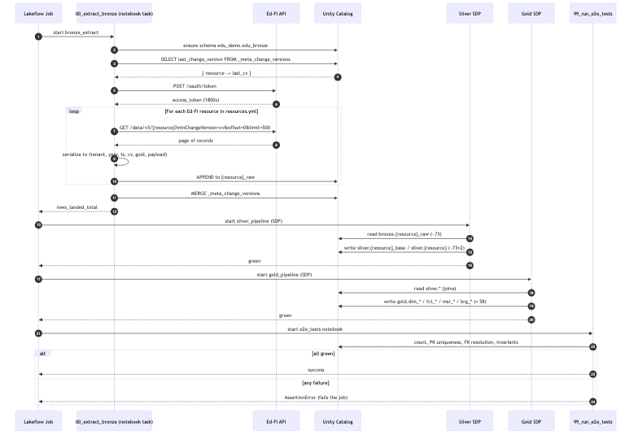

# Architecture

This document maps the **Enable Data Union (EDU)** reference architecture component-by-component to the **Databricks-native equivalent** we ship here.

## EDU reference (what we're replicating)

```
┌──────────────┐       ┌─────────────────┐       ┌──────────────────┐
│   Ed-Fi ODS  │──API─▶│  Apache Airflow │──S3──▶│    Snowflake     │
│ (district/   │       │  + EdFi client  │       │  (raw schema)    │
│  state)      │       │  + Snowflake op │       └─────────┬────────┘
└──────────────┘       └─────────────────┘                 │
                                                            │  dbt run
                                                            ▼
                                              ┌────────────────────────┐
                                              │   edu_edfi_source      │
                                              │   (base_, stg_ stage)  │
                                              └────────────┬───────────┘
                                                           │
                                                           ▼
                                              ┌────────────────────────┐
                                              │   edu_wh               │
                                              │   (core_warehouse:     │
                                              │   dim_*, fct_*)        │
                                              └────────────────────────┘
```

Upstream repos:
- [`edanalytics/edu_edfi_airflow`](https://github.com/edanalytics/edu_edfi_airflow) — Airflow DAGs
- [`edanalytics/edfi_api_client`](https://github.com/edanalytics/edfi_api_client) — Python Ed-Fi client
- [`edanalytics/edu_edfi_source`](https://github.com/edanalytics/edu_edfi_source) — dbt staging package (269 SQLs)
- [`edanalytics/edu_wh`](https://github.com/edanalytics/edu_wh) — dbt warehouse package (120 SQLs)

## Our Databricks-native equivalent

```
┌──────────────┐         ┌──────────────────────┐
│   Ed-Fi ODS  │──API───▶│  Lakeflow Job task   │
│ (or sandbox  │         │  bronze_extract      │
│  or synth.)  │         │  (notebooks/00_*)    │
└──────────────┘         └─────────┬────────────┘
                                   │ Delta
                                   ▼
                  ┌─────────────────────────────────┐
                  │  Unity Catalog                  │
                  │  edu_bronze.{resource}_raw      │
                  │  + _meta_change_versions        │
                  └─────────────┬───────────────────┘
                                │
                                ▼
                  ┌─────────────────────────────────┐
                  │  Lakeflow SDP — Silver          │
                  │  (one *_base + one * per        │
                  │   resource, generated from      │
                  │   resources.yml)                │
                  └─────────────┬───────────────────┘
                                │
                                ▼
                  ┌─────────────────────────────────┐
                  │  Lakeflow SDP — Gold            │
                  │  (dim_*, fct_*, msr_*, brg_*)   │
                  └─────────────┬───────────────────┘
                                │
                                ▼
                  ┌─────────────────────────────────┐
                  │  E2E test task                  │
                  │  (PK uniqueness, FK resolution, │
                  │   business invariants)          │
                  └─────────────────────────────────┘
```

## Runtime flow (per job run)



## Component-by-component mapping

### 1. Ed-Fi API client

| EDU                                          | This project                                                |
| -------------------------------------------- | ----------------------------------------------------------- |
| `edfi_api_client.EdFiClient`                 | `src/edfi_extract/client.py :: EdFiClient`                  |
| OAuth2 client_credentials with token cache   | Same — see `EdFiClient._refresh_token`                      |
| Paged GET with `limit`/`offset`              | Same — see `EdFiClient.get_resource` (yields pages)         |
| Change-query window (`minChangeVersion`)     | Same — `min_change_version` / `max_change_version` kwargs   |
| Retries with backoff                         | Same — exponential backoff on 408/429/5xx, token-refresh on 401 |
| Latest-change-version lookup                 | Same — `get_latest_change_version()` reads `/changeQueries/v1/availableChangeVersions` |

The Python client is intentionally minimal (~150 LOC) and dependency-free except for `requests`. It runs identically on a Databricks cluster, on serverless, and inside `pytest`.

### 2. Extraction & landing

| EDU                                                    | This project                                              |
| ------------------------------------------------------ | --------------------------------------------------------- |
| `EdFiToObjectStorageOperator` → S3                     | Skipped — write directly to Delta                         |
| `ObjectStorageToDatabaseOperator` → Snowflake VARIANT  | `extractor.extract_resource()` → Delta with `payload STRING` |
| `_meta_change_versions` table                          | Same — `{catalog}.{bronze_schema}._meta_change_versions`  |
| `full_refresh` toggle                                  | Same — `full_refresh` job parameter                       |
| Per-DAG `tenant_code`, `api_year`                      | Same — job parameters                                     |

We collapse EDU's two-hop landing (S3 → Snowflake VARIANT) into a single Delta write because Delta *is* a lakehouse-native open format. Bronze tables are append-only and partitioned implicitly by `pull_change_version` for query pruning.

### 3. Silver staging

| EDU                                                | This project                                            |
| -------------------------------------------------- | ------------------------------------------------------- |
| `edu_edfi_source.models.staging.edfi_3.base.*`     | `silver.{resource}_base` (one SDP table per resource)   |
| `edu_edfi_source.models.staging.edfi_3.stage.*`    | `silver.{resource}` (deduplicated)                      |
| `extract_descriptor()` macro                       | `silver.transforms.extract_descriptor()`                |
| Descriptor seeds (code → label)                    | EDU `*Descriptors` endpoints → `silver/pipeline.py::_descriptors` lookup; `silver.transforms.resolve_descriptors()` swaps codes for `shortDescription` (key-feeding descriptors stay as codeValue). See `docs/DESCRIPTOR_RESOLUTION.md`. |
| `dbt_utils.generate_surrogate_key()` macro         | `silver.transforms.surrogate_key()`                     |
| `dbt_utils.deduplicate()` macro                    | `silver.transforms.dedupe_latest()`                     |
| Per-model SQL files                                | Metadata-driven generator reads `resources.yml`         |

The Silver layer is programmatically generated from `resources.yml`. EDU writes ~270 hand-coded staging SQLs; we get the same surface from one YAML file + ~150 lines of Python.

For each resource a base table extracts a curated set of typed columns (per the `RECIPES` dict in `silver/recipes.py`) plus the raw `payload` for ad-hoc downstream access. The stage table dedupes on a surrogate key built from the resource's `key_paths` from `resources.yml`.

### 4. Gold warehouse

| EDU                                                    | This project                                            |
| ------------------------------------------------------ | ------------------------------------------------------- |
| `edu_wh.models.core_warehouse.dim_*`                   | `src/gold/pipeline.py` — `@dlt.table` defs              |
| `edu_wh.models.core_warehouse.fct_*`                   | Same — facts as `@dlt.table` defs                       |
| Surrogate keys via `dbt_utils.generate_surrogate_key`  | `gold.shared.keys.k_*` helpers (MD5 of lowercased parts, matches EDU 1:1) |
| Post-hooks for PK constraints                          | Implicit — uniqueness validated by E2E test task        |
| Jinja-templated program aggregators (`bld_ef3__*`)     | Inlined in dimension definitions (the configurable subset, surfaced as bundle variables) |
| Business-rule columns                                  | Chronic-absence flag, program active/annual flags, and the federal race/ethnicity rollup — tunable via bundle variables (`silver.transforms.chronic_absent_flag` / `program_window_flags` / `race_ethnicity_rollup`) |

Gold marts are PySpark — every one names the EDU dbt model it replaces in its `comment`. Joins between facts and dims compose on the same surrogate-key columns EDU uses, so any analyst trained on EDU can query our marts identically.

### 5. Orchestration

| Airflow construct                          | Lakeflow equivalent                                   |
| ------------------------------------------ | ----------------------------------------------------- |
| DAG                                        | Lakeflow Job (`resources/ingestion_job.yml`)          |
| Task                                       | Job task (`notebook_task` or `pipeline_task`)         |
| TaskGroup                                  | Sequential `depends_on` chain                         |
| Operator                                   | Notebook or SDP                                       |
| Variable                                   | Job parameter or DAB variable                         |
| Pool                                       | Compute environment (serverless by default)           |
| `default_args` retries                     | Per-task `max_retries`                                |
| Schedule                                   | Cron in `schedule.quartz_cron_expression`             |

### 6. Testing

| EDU                            | This project                                                   |
| ------------------------------ | -------------------------------------------------------------- |
| dbt tests (`not_null`, `unique`) | Inline in `notebooks/99_run_e2e_tests.py`, fails the job task  |
| dbt-expectations               | Custom assertions (business-logic invariants)                  |
| Manual integration runs        | DAB `databricks bundle run` exercises the full pipeline        |
| (none)                         | pytest unit tests for the client, synthetic data, and transforms |

## Operational notes

### Serverless

The default deployment uses **serverless** for both SDPs and the bronze notebook task. This avoids cluster-startup latency and supports custom Python packages via the `environment_key` mechanism.

### Schema evolution

Bronze tables enable Delta CDF (`'delta.enableChangeDataFeed' = 'true'`) so the silver SDP can be flipped to a streaming pattern when desired. Today both SDPs use **triggered batch mode** (matches EDU's daily-DAG cadence).

### Cost shape

| Workload                | Compute              | Typical run length on synthetic data |
| ----------------------- | -------------------- | ------------------------------------ |
| Bronze extract notebook | Serverless           | <2 min                               |
| Silver SDP              | Serverless (Photon)  | 1–3 min                              |
| Gold SDP                | Serverless (Photon)  | 1–2 min                              |
| E2E test                | Serverless           | <1 min                               |

On a real Ed-Fi ODS, the bronze step is paging-bound (HTTP throughput) and will dominate. Silver/Gold scale linearly with bronze row counts.

### Real-data validation

The pipeline is live-verified end-to-end against the Ed-Fi public sandbox (v7.3.2) — see `docs/REAL_DATA_VALIDATION.md`. `make smoke` runs a fast scoped pull (a subset of resources + descriptors) into isolated `edu_*_smoke` schemas to exercise the real-data path without a full historical load.
